# Práctica 1.8 — Implantación de PrestaShop con Pila LAMP, HTTPS (Let's Encrypt) y Vagrant


**Autor:** Alejandro Duque  
**Módulo:** Implantación de Aplicaciones Web (IAW) — 2º ASIR  
**Curso:** 2026/2027  

---

## Índice de contenidos

1. [Introducción y arquitectura del entorno](#1-introducción-y-arquitectura-del-entorno)
2. [Despliegue de la infraestructura con Vagrant y VMware](#2-despliegue-de-la-infraestructura-con-vagrant-y-vmware)
3. [Resolución DNS dinámica con DuckDNS](#3-resolución-dns-dinámica-con-duckdns)
4. [Gestión de variables de entorno y seguridad](#4-gestión-de-variables-de-entorno-y-seguridad)
5. [Instalación de la pila LAMP, phpMyAdmin y cortafuegos UFW](#5-instalación-de-la-pila-lamp-phpmyadmin-y-cortafuegos-ufw)
6. [Certificado SSL/TLS con Let's Encrypt y Certbot](#6-certificado-ssltls-con-lets-encrypt-y-certbot)
7. [Auditoría previa (`PhpPsInfo`) e instalación CLI de PrestaShop 9](#7-auditoría-previa-phppsinfo-e-instalación-cli-de-prestashop-9)
8. [Comprobación final del funcionamiento](#8-comprobación-final-del-funcionamiento)
9. [Incidencias encontradas y soluciones aplicadas](#9-incidencias-encontradas-y-soluciones-aplicadas)
10. [Decisiones técnicas y mejoras respecto al enunciado](#10-decisiones-técnicas-y-mejoras-respecto-al-enunciado)
11. [Referencias y licencia](#11-referencias-y-licencia)

---

## 1. Introducción y arquitectura del entorno

El objetivo de esta práctica es automatizar mediante scripts de **Bash** el despliegue completo de la aplicación web **PrestaShop 9** sobre una pila **LAMP** (**Linux, Apache 2, MariaDB y PHP 8.2**) con **phpMyAdmin** y cifrado **HTTPS** mediante un certificado válido de **Let's Encrypt**.

**PrestaShop** es un sistema gestor de contenidos (CMS) de código abierto especializado en comercio electrónico (*e-commerce*), estructurado en dos áreas principales:

* **Front-Office (Tienda pública):** interfaz visible para los clientes donde consultan el catálogo, filtran productos y tramitan pedidos.
* **Back-Office (Panel de administración):** entorno privado protegido para gestionar inventario, precios, pedidos, transportistas, módulos y configuración de la tienda.

En lugar de utilizar una instancia EC2 en Amazon Web Services (AWS), se ha implementado una infraestructura virtualizada en local orquestada con **Vagrant** sobre **VMware Workstation (`vmware_desktop`)** en un equipo anfitrión **CachyOS Linux**:

| Componente | Especificación / Valor | Función en el despliegue |
| :--- | :--- | :--- |
| **Hipervisor** | VMware Workstation (`vmware_desktop`) | Ejecución de la máquina virtual en red privada (`192.168.56.0/24`) |
| **Orquestación** | Vagrant | Creación, sincronización (`rsync`) y aprovisionamiento modular |
| **Sistema Operativo** | Debian 12 (*Bookworm* — `generic/debian12`) | Sistema base del servidor web y de base de datos |
| **Recursos asignados** | 2 vCPU y 2048 MB de RAM | Requisitos óptimos para ejecutar PrestaShop 9 sin cuellos de botella |
| **Dirección IP fija** | `192.168.56.10` | Interfaz *host-only* accesible directamente desde el anfitrión |
| **Dominio dinámico** | `alejandroduque-ps.duckdns.org` | Nombre de dominio resuelto mediante DuckDNS |
| **Certificado SSL/TLS** | Let's Encrypt (ECDSA — desafío `DNS-01`) | Cifrado HTTPS válido y renovación automática vía Certbot |
| **Pila LAMP y gestión** | Apache 2.4, MariaDB 10.11, PHP 8.2.36 y phpMyAdmin | Servidor web, motor de base de datos y administración web |
| **Seguridad perimetral** | Cortafuegos UFW | Filtrado de puertos (`22/tcp` en NAT, `80/tcp` y `443/tcp`) |
| **Aplicación desplegada** | PrestaShop `9.0.0-1.0` | Tienda online instalada de forma desatendida por CLI |

### Estructura del repositorio

```text
.
├── capturas/                       # Evidencias gráficas del despliegue y verificación
├── conf/
│   ├── 000-default.conf            # VirtualHost HTTP (puerto 80) y redirección a HTTPS
│   └── default-ssl.conf            # VirtualHost HTTPS (puerto 443) con certificados Let's Encrypt
├── screencast/
│   └── prestashop.mp4              # Vídeo demostrativo del funcionamiento y seguridad
├── scripts/
│   ├── .env                        # Plantilla pública de variables de configuración
│   ├── deploy_prestashop.sh        # Despliegue de PrestaShop, PhpPsInfo, instalación CLI y limpieza
│   ├── install_lamp.sh             # Instalación de Apache, MariaDB, PHP 8.2, phpMyAdmin y UFW
│   └── setup_letsencrypt_https.sh  # Emisión del certificado Let's Encrypt (DNS-01) y HTTPS
├── Vagrantfile                     # Definición de la VM y aprovisionadores por fases
└── README.md                       # Documentación técnica de la práctica
```

> **Nota de seguridad:** El archivo `scripts/.env.local` (que contiene las contraseñas reales) y el directorio interno `.vagrant/` se mantienen únicamente en local y no se publican en el repositorio.

---

## 2. Despliegue de la infraestructura con Vagrant y VMware

### 2.1 Configuración del `Vagrantfile`

Se define una máquina virtual llamada **`AlejandroDuquePrestashop`** basada en `generic/debian12`, con sincronización mediante `rsync` hacia `/vagrant` y cuatro aprovisionadores independientes con `run: "never"` para controlar cada fase de la práctica bajo demanda:

```ruby
Vagrant.configure("2") do |config|
  config.vm.box = "generic/debian12"

  config.vm.synced_folder ".", "/vagrant", type: "rsync",
    rsync__exclude: [".vagrant/", "capturas/", "screencast/"]

  config.vm.define "AlejandroDuquePrestashop" do |ps|
    ps.vm.hostname = "AlejandroDuquePrestashop"
    ps.vm.network "private_network", ip: "192.168.56.10"

    ps.vm.provider "vmware_desktop" do |v|
      v.gui = false
      v.memory = "2048"
      v.cpus = 2
      v.linked_clone = false
    end

    # Aprovisionadores bajo demanda (3 scripts)
    ps.vm.provision "lamp", type: "shell", path: "scripts/install_lamp.sh", run: "never"

    ps.vm.provision "https", type: "shell", path: "scripts/setup_letsencrypt_https.sh",
      env: { "DUCKDNS_TOKEN" => ENV.fetch("DUCKDNS_TOKEN", "") }, run: "never"

    ps.vm.provision "prestashop-info", type: "shell",
      path: "scripts/deploy_prestashop.sh", args: ["preparar"], run: "never"

    ps.vm.provision "prestashop-install", type: "shell",
      path: "scripts/deploy_prestashop.sh", args: ["instalar"], run: "never"
  end
end
```

**Detalles clave de la configuración:**

* **`config.vm.synced_folder` con `type: "rsync"`:** garantiza que los directorios `scripts/` y `conf/` estén disponibles en `/vagrant` dentro de Debian 12 sin depender de módulos HGFS de VMware, excluyendo ficheros pesados como `.vagrant/`, `capturas/` y `screencast/`.
* **`private_network` (`192.168.56.10`):** asigna una IP estática accesible directamente en los puertos estándar `80` y `443` desde el navegador del equipo anfitrión.
* **`run: "never"`:** evita que los scripts se lancen automáticamente durante `vagrant up`, permitiendo ejecutar cada fase de forma ordenada mediante `vagrant provision --provision-with <nombre>`.
* **`env: { "DUCKDNS_TOKEN" => ... }`:** inyecta el token de la API de DuckDNS desde una variable de entorno de sesión del anfitrión sin almacenarlo en ningún fichero del repositorio.

### 2.2 Arranque inicial de la máquina virtual

Iniciamos las redes virtuales de VMware, levantamos la máquina sin aprovisionar y verificamos su estado:

```bash
sudo vmware-networks --start
vagrant up --no-provision
vagrant status
```

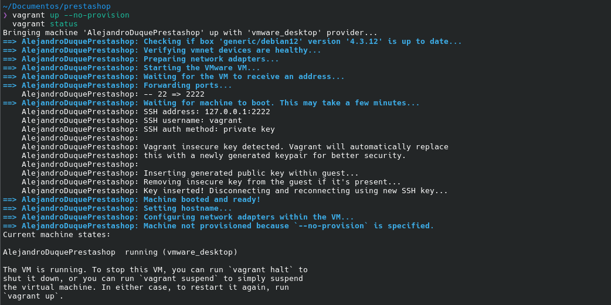

*Captura del arranque correcto de la VM `AlejandroDuquePrestashop` en estado `running (vmware_desktop)`.*

---

## 3. Resolución DNS dinámica con DuckDNS

Para poder solicitar un certificado SSL válido de **Let's Encrypt** y acceder a la tienda mediante un nombre de dominio real, se registra el subdominio **`alejandroduque-ps.duckdns.org`** en [DuckDNS](https://www.duckdns.org/) apuntando a la IP privada de la máquina virtual (**`192.168.56.10`**).

Comprobamos desde la terminal del equipo anfitrión que la resolución DNS devuelve correctamente la dirección IP de la máquina virtual:

```bash
nslookup alejandroduque-ps.duckdns.org
```

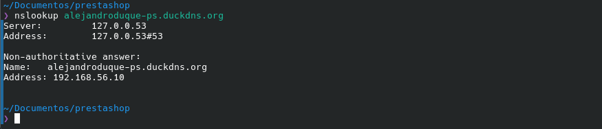

*Captura de `nslookup` confirmando que `alejandroduque-ps.duckdns.org` resuelve a `192.168.56.10`.*

---

## 4. Gestión de variables de entorno y seguridad

Para centralizar todos los parámetros del despliegue sin exponer contraseñas en GitHub, se utiliza el archivo público **`scripts/.env`** con marcadores de posición (`CAMBIAR_en_env_local`):

```bash
# Dominio en DuckDNS (sin .duckdns.org)
DUCKDNS_SUBDOMAIN="alejandroduque-ps"
DOMINIO="${DUCKDNS_SUBDOMAIN}.duckdns.org"

# Lets Encrypt ("true" para pruebas, "false" para certificado real)
LE_EMAIL="CAMBIAR_en_env_local"
LE_STAGING="false"

# Base de datos MariaDB
DB_NAME="prestashop_db"
DB_USER="ps_usuario"
DB_PASS="CAMBIAR_en_env_local"

# phpMyAdmin
PMA_APP_PASS="CAMBIAR_en_env_local"

# Directivas PHP requeridas y recomendadas por PrestaShop
PHP_MEMORY_LIMIT="512M"
PHP_MAX_INPUT_VARS="5000"
PHP_POST_MAX_SIZE="128M"
PHP_UPLOAD_MAX_FILESIZE="128M"
PS_ZONA_HORARIA="Europe/Madrid"

# Parametros de la tienda PrestaShop
PS_VERSION="9.0.0-1.0"
PS_NOMBRE_TIENDA="Tienda Alejandro Duque"
PS_NOMBRE_ADMIN="Alejandro"
PS_APELLIDOS_ADMIN="Duque"
PS_ADMIN_EMAIL="CAMBIAR_en_env_local"
PS_ADMIN_PASS="CAMBIAR_en_env_local"
PS_PAIS="es"
PS_IDIOMA="es"
```

Los scripts cargan primero `scripts/.env` y, si existe en local, sobrescriben las credenciales con `scripts/.env.local`. Si alguna variable crítica conserva el prefijo `CAMBIAR`, la ejecución se detiene inmediatamente con un mensaje de error.

---

## 5. Instalación de la pila LAMP, phpMyAdmin y cortafuegos UFW

### 5.1 Plantilla del VirtualHost HTTP (`conf/000-default.conf`)

```apache
<VirtualHost *:80>
    ServerName __DOMINIO__
    DocumentRoot /var/www/html

    <Directory /var/www/html>
        Options FollowSymLinks
        AllowOverride All
        Require all granted
    </Directory>

    ErrorLog ${APACHE_LOG_DIR}/ps-http-error.log
    CustomLog ${APACHE_LOG_DIR}/ps-http-access.log combined
</VirtualHost>
```

La directiva **`AllowOverride All`** resulta indispensable para que Apache 2 procese el archivo `.htaccess` generado por PrestaShop y habilite las URL amigables.

### 5.2 Script de instalación (`scripts/install_lamp.sh`)

```bash
#!/bin/bash
set -euo pipefail

DIR="/vagrant/scripts"
RAIZ_REPO="/vagrant"

set -a
source "$DIR/.env"
[[ -f "$DIR/.env.local" ]] && source "$DIR/.env.local"
set +a

for var in DB_PASS PMA_APP_PASS; do
  if [[ "${!var}" == CAMBIAR* ]]; then
    echo "ERROR: define ${var} en scripts/.env.local" >&2
    exit 1
  fi
done

export DEBIAN_FRONTEND=noninteractive

echo "[1/7] Instalando Apache 2, MariaDB, PHP 8.2, extensiones recomendadas y UFW..."
apt-get update -y
apt-get install -y apache2 mariadb-server php libapache2-mod-php php-cli \
  php-mysql php-curl php-gd php-intl php-mbstring php-xml php-zip php-bcmath \
  php-imagick php-memcached unzip curl openssl ca-certificates ufw

echo "[2/7] Configurando directivas de PHP para PrestaShop..."
PHP_VER="$(php -r 'echo PHP_MAJOR_VERSION.".".PHP_MINOR_VERSION;')"
for sapi in apache2 cli; do
  cat > "/etc/php/${PHP_VER}/${sapi}/conf.d/99-prestashop.ini" <<EOF
memory_limit = ${PHP_MEMORY_LIMIT}
max_input_vars = ${PHP_MAX_INPUT_VARS}
post_max_size = ${PHP_POST_MAX_SIZE}
upload_max_filesize = ${PHP_UPLOAD_MAX_FILESIZE}
date.timezone = ${PS_ZONA_HORARIA}
EOF
done

echo "[3/7] Creando base de datos y usuario dedicado en MariaDB..."
mariadb -e "CREATE DATABASE IF NOT EXISTS \`${DB_NAME}\` CHARACTER SET utf8mb4 COLLATE utf8mb4_unicode_ci;"
mariadb -e "DROP USER IF EXISTS '${DB_USER}'@'localhost';"
mariadb -e "CREATE USER '${DB_USER}'@'localhost' IDENTIFIED BY '${DB_PASS}';"
mariadb -e "GRANT ALL PRIVILEGES ON \`${DB_NAME}\`.* TO '${DB_USER}'@'localhost';"
mariadb -e "FLUSH PRIVILEGES;"

echo "[4/7] Instalando phpMyAdmin de forma desatendida..."
echo "phpmyadmin phpmyadmin/dbconfig-install boolean true" | debconf-set-selections
echo "phpmyadmin phpmyadmin/app-password-confirm password ${PMA_APP_PASS}" | debconf-set-selections
echo "phpmyadmin phpmyadmin/mysql/app-pass password ${PMA_APP_PASS}" | debconf-set-selections
echo "phpmyadmin phpmyadmin/reconfigure-webserver multiselect apache2" | debconf-set-selections
apt-get install -y phpmyadmin

echo "[5/7] Configurando módulos y VirtualHost HTTP en Apache 2..."
a2enmod rewrite ssl headers >/dev/null
echo "ServerName ${DOMINIO}" > /etc/apache2/conf-available/servername.conf
a2enconf servername >/dev/null
sed "s/__DOMINIO__/${DOMINIO}/g" "$RAIZ_REPO/conf/000-default.conf" > /etc/apache2/sites-available/000-default.conf
apache2ctl configtest
systemctl restart apache2

echo "[6/7] Configurando cortafuegos UFW (SSH en NAT, HTTP 80 y HTTPS 443)..."
IF_NAT=$(ip -o -4 route show to default | awk '{print $5}' | head -n1)
ufw --force reset
ufw default deny incoming
ufw default allow outgoing
ufw allow in on "$IF_NAT" to any port 22 proto tcp
ufw allow 80/tcp
ufw allow 443/tcp
ufw --force enable

echo "[7/7] Pila LAMP, phpMyAdmin y UFW operativos."
```

**Aspectos destacados de `install_lamp.sh`:**

* **Extensiones PHP completas:** además de las obligatorias (`mysql`, `curl`, `gd`, `intl`, `mbstring`, `xml`, `zip`), se incluyen las extensiones recomendadas (`php-bcmath`, `php-imagick` y `php-memcached`) para maximizar el rendimiento y superar todas las comprobaciones de `PhpPsInfo`.
* **Ajuste limpio de PHP (`99-prestashop.ini`):** aplica los valores recomendados tanto para Apache (`apache2`) como para el instalador por consola (`cli`).
* **Principio de mínimo privilegio en MariaDB:** crea `prestashop_db` con codificación `utf8mb4_unicode_ci` y concede permisos exclusivamente al usuario `ps_usuario`@`localhost`.
* **Cortafuegos UFW:** replica las reglas de seguridad solicitadas en el enunciado (denegar tráfico entrante por defecto y abrir únicamente SSH en la interfaz NAT `eth0`, HTTP `80/tcp` y HTTPS `443/tcp`).

### 5.3 Ejecución y verificación de servicios, BD y cortafuegos

```bash
vagrant provision --provision-with lamp
vagrant ssh -c "sudo systemctl status apache2 mariadb --no-pager | head -n 18 && php -v | head -n 1 && sudo mariadb -e \"SHOW DATABASES; SELECT user, host FROM mysql.user WHERE user='ps_usuario';\" && sudo ufw status verbose"
```

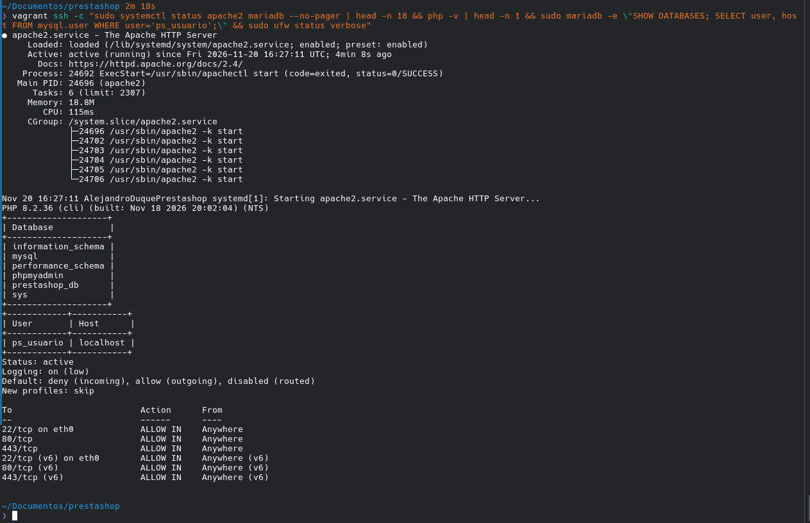

*Captura verificando Apache 2 activo, PHP 8.2.36, la base de datos `prestashop_db`, el usuario `ps_usuario`@`localhost` y las reglas del cortafuegos UFW.*

---

## 6. Certificado SSL/TLS con Let's Encrypt y Certbot

### 6.1 Plantilla del VirtualHost HTTPS (`conf/default-ssl.conf`)

```apache
<VirtualHost *:443>
    ServerName __DOMINIO__
    DocumentRoot /var/www/html

    SSLEngine on
    SSLCertificateFile /etc/letsencrypt/live/__DOMINIO__/fullchain.pem
    SSLCertificateKeyFile /etc/letsencrypt/live/__DOMINIO__/privkey.pem

    <Directory /var/www/html>
        Options FollowSymLinks
        AllowOverride All
        Require all granted
    </Directory>

    ErrorLog ${APACHE_LOG_DIR}/ps-ssl-error.log
    CustomLog ${APACHE_LOG_DIR}/ps-ssl-access.log combined
</VirtualHost>
```

### 6.2 Script de emisión y renovación (`scripts/setup_letsencrypt_https.sh`)

Como la máquina virtual opera en una red privada (`192.168.56.10`) sin IP pública entrante en el puerto 80 desde Internet, no es posible usar el reto `HTTP-01`. En su lugar, se automatiza el **desafío `DNS-01`** mediante la API de DuckDNS, creando dinámicamente el registro TXT `_acme-challenge` durante la validación y eliminándolo al finalizar:

```bash
#!/bin/bash
set -euo pipefail

DIR="/vagrant/scripts"
RAIZ_REPO="/vagrant"

set -a
source "$DIR/.env"
[[ -f "$DIR/.env.local" ]] && source "$DIR/.env.local"
set +a

: "${DUCKDNS_TOKEN:?ERROR: exporta DUCKDNS_TOKEN en el equipo anfitrión}"
if [[ "${LE_EMAIL}" == CAMBIAR* ]]; then
  echo "ERROR: define LE_EMAIL en scripts/.env.local" >&2
  exit 1
fi

export DEBIAN_FRONTEND=noninteractive
DIR_HOOKS="/etc/letsencrypt/duckdns"

echo "[1/4] Instalando Certbot..."
apt-get update -y
apt-get install -y certbot curl

echo "[2/4] Configurando hooks de validación DNS-01 con DuckDNS..."
install -d -m 700 "$DIR_HOOKS"
printf 'DUCKDNS_TOKEN=%s\n' "$DUCKDNS_TOKEN" > "$DIR_HOOKS/duckdns.env"
chmod 600 "$DIR_HOOKS/duckdns.env"

cat > "$DIR_HOOKS/auth-hook.sh" <<'EOF'
#!/bin/bash
set -e
source /etc/letsencrypt/duckdns/duckdns.env
SUB="${CERTBOT_DOMAIN%.duckdns.org}"
[[ "$(curl -s "https://www.duckdns.org/update?domains=${SUB}&token=${DUCKDNS_TOKEN}&txt=${CERTBOT_VALIDATION}")" = "OK" ]]
sleep 30
EOF

cat > "$DIR_HOOKS/cleanup-hook.sh" <<'EOF'
#!/bin/bash
source /etc/letsencrypt/duckdns/duckdns.env
SUB="${CERTBOT_DOMAIN%.duckdns.org}"
curl -s "https://www.duckdns.org/update?domains=${SUB}&token=${DUCKDNS_TOKEN}&txt=clear&clear=true" > /dev/null
EOF

install -d /etc/letsencrypt/renewal-hooks/deploy
cat > /etc/letsencrypt/renewal-hooks/deploy/reload-apache.sh <<'EOF'
#!/bin/bash
systemctl reload apache2 || true
EOF

chmod 700 "$DIR_HOOKS/auth-hook.sh" "$DIR_HOOKS/cleanup-hook.sh"
chmod 755 /etc/letsencrypt/renewal-hooks/deploy/reload-apache.sh

echo "[3/4] Solicitando certificado Let's Encrypt para ${DOMINIO}..."
OPCION_STAGING=()
if [[ "${LE_STAGING}" == "true" ]]; then
  OPCION_STAGING=(--staging)
fi

RENOVACION="/etc/letsencrypt/renewal/${DOMINIO}.conf"
if [[ "${LE_STAGING}" != "true" && -f "$RENOVACION" ]] && grep -q "staging" "$RENOVACION"; then
  certbot delete --cert-name "$DOMINIO" --non-interactive
fi

certbot certonly --manual --preferred-challenges dns \
  --manual-auth-hook "$DIR_HOOKS/auth-hook.sh" \
  --manual-cleanup-hook "$DIR_HOOKS/cleanup-hook.sh" \
  -d "$DOMINIO" --cert-name "$DOMINIO" \
  --email "$LE_EMAIL" --agree-tos --no-eff-email \
  --non-interactive --keep-until-expiring \
  "${OPCION_STAGING[@]}"

echo "[4/4] Activando VirtualHost HTTPS y redirección permanente HTTP -> HTTPS..."
sed -e "s/__DOMINIO__/${DOMINIO}/g" \
    -e "/ServerName/a \    Redirect permanent / https://${DOMINIO}/" \
    "$RAIZ_REPO/conf/000-default.conf" > /etc/apache2/sites-available/000-default.conf

sed "s/__DOMINIO__/${DOMINIO}/g" "$RAIZ_REPO/conf/default-ssl.conf" > /etc/apache2/sites-available/default-ssl.conf
a2ensite default-ssl.conf >/dev/null
apache2ctl configtest
systemctl reload apache2

echo "HTTPS activo en https://${DOMINIO}"
```

### 6.3 Verificación del certificado y acceso seguro a phpMyAdmin

Ejecutamos el aprovisionador `https` y verificamos el estado del certificado emitido:

```bash
env DUCKDNS_TOKEN="<TOKEN_DUCKDNS>" vagrant provision --provision-with https
vagrant ssh -c "sudo certbot certificates"
```

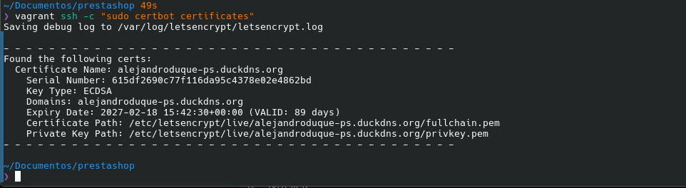

*Captura de `sudo certbot certificates` mostrando el certificado ECDSA válido durante 89 días para `alejandroduque-ps.duckdns.org`.*

Al acceder desde el navegador a **`https://alejandroduque-ps.duckdns.org/phpmyadmin`** con el usuario **`ps_usuario`**, comprobamos que el candado SSL está verificado por **Let's Encrypt** y que tenemos acceso a la base de datos **`prestashop_db`**:

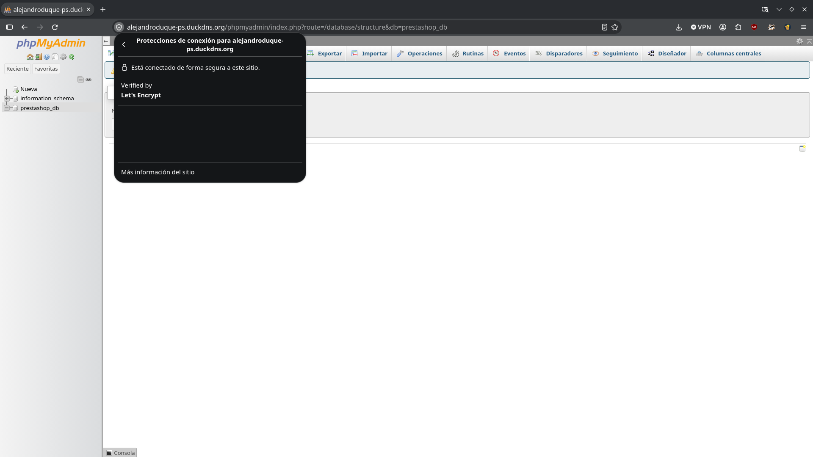

*Captura de phpMyAdmin bajo HTTPS verificado por Let's Encrypt mostrando la base de datos `prestashop_db`.*

---

## 7. Auditoría previa (`PhpPsInfo`) e instalación CLI de PrestaShop 9

### 7.1 Script de despliegue e instalación (`scripts/deploy_prestashop.sh`)

Para cumplir con el flujo del enunciado sin duplicar ficheros ni modificar scripts a mitad del proceso, `deploy_prestashop.sh` admite dos modos de ejecución (`preparar` e `instalar`, o ambos seguidos si se invoca sin argumentos):

```bash
#!/bin/bash
set -euo pipefail

MODO="${1:-todo}"
DIR="/vagrant/scripts"
RAIZ_WEB="/var/www/html"

set -a
source "$DIR/.env"
[[ -f "$DIR/.env.local" ]] && source "$DIR/.env.local"
set +a

for var in DB_PASS PS_ADMIN_EMAIL PS_ADMIN_PASS; do
  if [[ "${!var}" == CAMBIAR* ]]; then
    echo "ERROR: define ${var} en scripts/.env.local" >&2
    exit 1
  fi
done

if [[ "$MODO" == "preparar" || "$MODO" == "todo" ]]; then
  TEMPORAL="$(mktemp -d)"

  echo "[1/3] Descargando PrestaShop ${PS_VERSION}..."
  curl -fL -o "$TEMPORAL/prestashop.zip" \
    "https://assets.prestashop3.com/dst/edition/corporate/${PS_VERSION}/prestashop_edition_classic_version_${PS_VERSION}.zip?source=vagrant"

  echo "[2/3] Descomprimiendo archivos en ${RAIZ_WEB}..."
  unzip -oq "$TEMPORAL/prestashop.zip" -d "$TEMPORAL/paquete"
  rm -rf "${RAIZ_WEB:?}"/*
  unzip -oq "$TEMPORAL/paquete/prestashop.zip" -d "$RAIZ_WEB"
  rm -rf "$TEMPORAL"

  echo "[3/3] Desplegando PhpPsInfo con credenciales personalizadas..."
  curl -fsSL -o "$RAIZ_WEB/phppsinfo.php" \
    "https://raw.githubusercontent.com/PrestaShop/php-ps-info/master/phppsinfo.php"
  sed -i "s/const DEFAULT_LOGIN = '[^']*';/const DEFAULT_LOGIN = 'psinfo';/" "$RAIZ_WEB/phppsinfo.php"
  sed -i "s/const DEFAULT_PASSWORD = '[^']*';/const DEFAULT_PASSWORD = '${PS_ADMIN_PASS}';/" "$RAIZ_WEB/phppsinfo.php"

  chown -R www-data:www-data "$RAIZ_WEB"
  echo "Auditoría lista en: https://${DOMINIO}/phppsinfo.php (usuario: psinfo)"
fi

if [[ "$MODO" == "instalar" || "$MODO" == "todo" ]]; then
  echo "[1/2] Ejecutando instalación CLI de PrestaShop..."
  cd "$RAIZ_WEB/install"
  runuser -u www-data -- php index_cli.php \
    --domain="${DOMINIO}" \
    --ssl=1 \
    --db_server="localhost" \
    --db_name="${DB_NAME}" \
    --db_user="${DB_USER}" \
    --db_password="${DB_PASS}" \
    --prefix="ad_" \
    --name="${PS_NOMBRE_TIENDA}" \
    --firstname="${PS_NOMBRE_ADMIN}" \
    --lastname="${PS_APELLIDOS_ADMIN}" \
    --email="${PS_ADMIN_EMAIL}" \
    --password="${PS_ADMIN_PASS}" \
    --country="${PS_PAIS}" \
    --language="${PS_IDIOMA}" \
    --timezone="${PS_ZONA_HORARIA}"
  cd /

  echo "[2/2] Limpieza de seguridad (install/, phppsinfo.php y directorio admin)..."
  rm -rf "$RAIZ_WEB/install" "$RAIZ_WEB/phppsinfo.php"
  if [[ -d "$RAIZ_WEB/admin" ]]; then
    mv "$RAIZ_WEB/admin" "$RAIZ_WEB/admin_alejandro"
  fi
  chown -R www-data:www-data "$RAIZ_WEB"
  systemctl reload apache2

  DIR_ADMIN=$(find "$RAIZ_WEB" -maxdepth 1 -type d -name "admin*" -printf "%f\n" | head -n1)
  echo "PrestaShop instalado correctamente."
  echo "Front-Office: https://${DOMINIO}"
  echo "Back-Office:  https://${DOMINIO}/${DIR_ADMIN}/"
fi
```

### 7.2 Auditoría de requisitos con `PhpPsInfo`

Ejecutamos la fase de preparación (`prestashop-info`) y accedemos a **`https://alejandroduque-ps.duckdns.org/phppsinfo.php`** autenticándonos con el usuario personalizado **`psinfo`**:

```bash
vagrant provision --provision-with prestashop-info
```

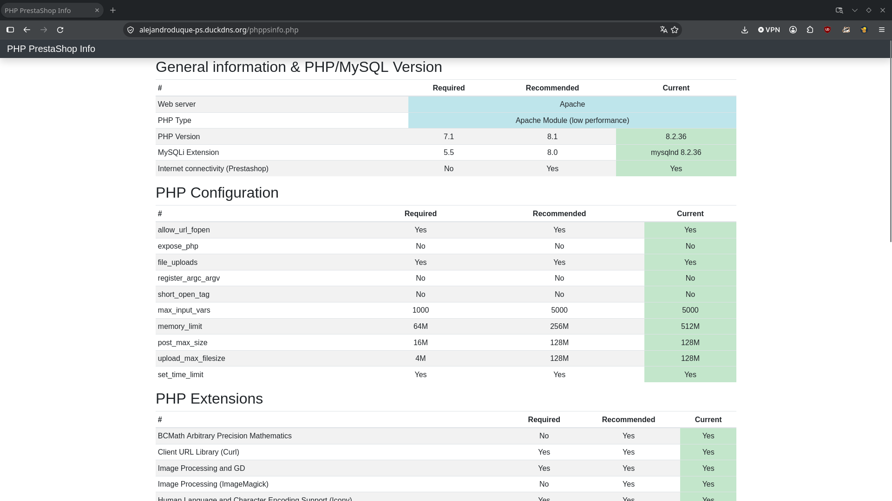

*Captura de `PhpPsInfo` (parte 1): información general, versiones de PHP/MySQL y directivas de `php.ini` en verde.*

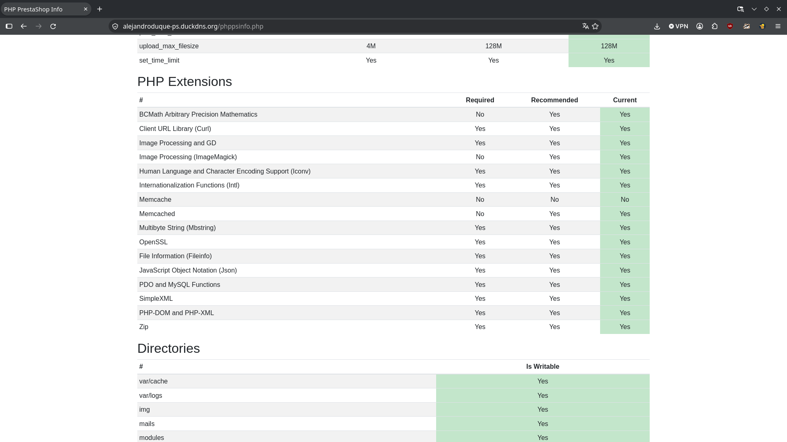

*Captura de `PhpPsInfo` (parte 2): todas las extensiones requeridas/recomendadas (`BCMath`, `Curl`, `GD`, `ImageMagick`, `Intl`, `Memcached`, `Mbstring`, `OpenSSL`, `SimpleXML`, `DOM`, `Zip`) y permisos de escritura en verde.*

### 7.3 Instalación CLI y endurecimiento posterior (*hardening*)

Lanzamos la instalación desatendida por línea de comandos mediante `index_cli.php` ejecutado como el usuario `www-data`:

```bash
vagrant provision --provision-with prestashop-install
```

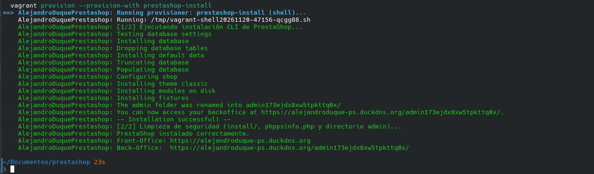

*Captura de la instalación CLI completada (`Installation successful!`) junto con la limpieza de seguridad y las URLs finales.*

Una vez finalizada la instalación:

1. El instalador renombra automáticamente la carpeta del panel de administración con un sufijo aleatorio (**`admin173ejdx8xw5tpkttq0x`**).
2. El script elimina automáticamente tanto el directorio **`/var/www/html/install`** como la herramienta **`/var/www/html/phppsinfo.php`** para evitar riesgos de seguridad en producción.

Comprobamos desde la terminal el listado limpio de `/var/www/html` y que ambas rutas devuelven **`HTTP/1.1 404 Not Found`**:

```bash
vagrant ssh -c "ls -la /var/www/html && curl -sI https://alejandroduque-ps.duckdns.org/phppsinfo.php | head -n 1 && curl -sI https://alejandroduque-ps.duckdns.org/install/ | head -n 1"
```

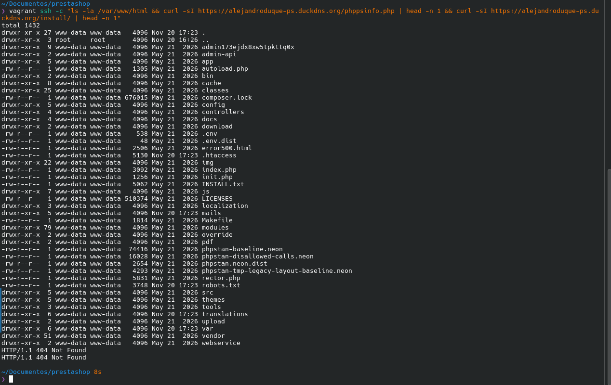

*Captura confirmando la ausencia de `install/` y `phppsinfo.php` en `/var/www/html` y la doble respuesta `HTTP/1.1 404 Not Found`.*

---

## 8. Comprobación final del funcionamiento

### 8.1 Tienda pública (*Front-Office*)

Accedemos a **`https://alejandroduque-ps.duckdns.org`**. La tienda carga correctamente con el tema *Classic* en español y con el certificado HTTPS validado por **Let's Encrypt**:

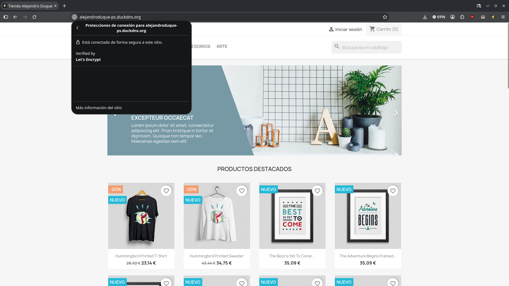

*Captura de la portada pública (*Front-Office*) de Tienda Alejandro Duque con candado HTTPS verificado por Let's Encrypt.*

### 8.2 Panel de administración (*Back-Office*)

Accedemos a la URL privada generada durante la instalación (**`https://alejandroduque-ps.duckdns.org/admin173ejdx8xw5tpkttq0x/`**) e iniciamos sesión con las credenciales de administrador configuradas:

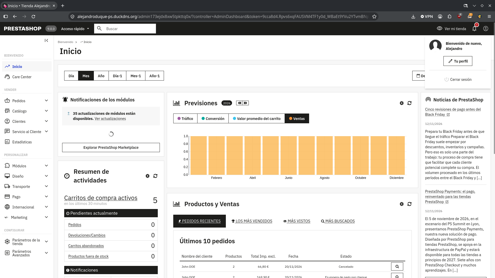

*Captura del panel de administración (*Back-Office*) de PrestaShop 9.0.0 operativo.*

### 8.3 Vídeo demostrativo (*Screencast*)

Se adjunta una grabación demostrativa en **`screencast/prestashop.mp4`** que recorre la tienda pública con el candado SSL activo, el acceso al panel de administración y la respuesta `404 Not Found` al intentar abrir `phppsinfo.php` tras la limpieza de seguridad:

* [Ver vídeo demostrativo (`screencast/prestashop.mp4`)](screencast/prestashop.mp4)

---

## 9. Incidencias encontradas y soluciones aplicadas

### Incidencia 1: Error al iniciar el servicio NAT en `vmnet8` de VMware

* **Descripción del problema:** Al ejecutar `sudo vmware-networks --start` y `vagrant up --no-provision`, VMware devolvió `Failed to start NAT service on vmnet8` y Vagrant detuvo el arranque de la máquina virtual por colisión con procesos residuales de red de prácticas anteriores.

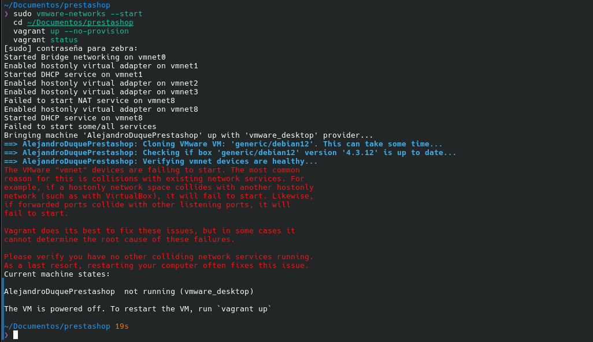

* **Solución aplicada:** Se detuvieron las redes virtuales de VMware, se finalizaron los procesos residuales `vmnet-natd`, se reinició el servicio `vagrant-vmware-utility` y se levantaron de nuevo las interfaces:

```bash
sudo vmware-networks --stop
sudo pkill -9 vmnet-natd 2>/dev/null; true
sudo systemctl restart vagrant-vmware-utility
sudo vmware-networks --start
```

### Incidencia 2: Carpeta `/vagrant` vacía dentro de Debian 12 en VMware

* **Descripción del problema:** Al lanzar la primera ejecución de `vagrant provision --provision-with lamp`, el script falló con `/vagrant/scripts/.env: No such file or directory` debido a que la caja base `generic/debian12` sobre `vmware_desktop` no monta automáticamente carpetas compartidas HGFS en `/vagrant`.

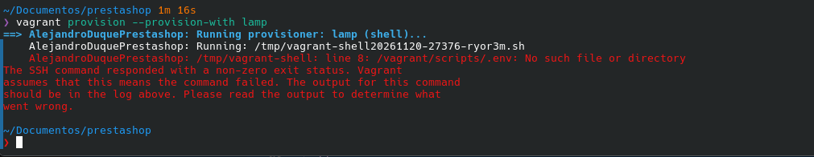

* **Solución aplicada:** Se configuró explícitamente la sincronización mediante **`rsync`** en el `Vagrantfile` (`config.vm.synced_folder ".", "/vagrant", type: "rsync"`) y se recargó la máquina con `vagrant reload --no-provision`, transfiriendo los directorios `scripts/` y `conf/` al interior de la VM antes de aprovisionar.

---

## 10. Decisiones técnicas y mejoras respecto al enunciado

| Requisito base (AWS) | Implementación realizada | Justificación técnica |
| :--- | :--- | :--- |
| Instancia EC2 Ubuntu (2 GB RAM) | VM Debian 12 (`2048 MB RAM`, `2 vCPU`) en Vagrant + VMware | Entorno local reproducible e idéntico en comportamiento a servidor cloud |
| Security Group (SSH, HTTP, HTTPS) | Cortafuegos **UFW** (`22/tcp` restringido a `eth0`, `80/tcp`, `443/tcp`) | Aislamiento a nivel de red equivalente a un grupo de seguridad |
| Dominio gratuito hacia IP del servidor | Subdominio DuckDNS apuntando a `192.168.56.10` | Acceso limpio mediante URL estándar sin puertos alternativos |
| Certificado SSL/TLS Let's Encrypt | Certbot con reto **`DNS-01`** vía API DuckDNS y redirección `301` | Emisión de certificado real sin necesidad de IP pública entrante |
| Variables en `scripts/.env` | Plantilla `.env` pública + `.env.local` privado + `ENV` para token | Ninguna contraseña ni token queda expuesto en el historial de GitHub |
| Auditoría con `PhpPsInfo` | Extensiones `imagick` y `memcached` + `99-prestashop.ini` | Supera el 100 % de requisitos y recomendaciones en verde |
| Seguridad post-instalación | Eliminación automática de `install/` y `phppsinfo.php` | Previene fugas de información del servidor y bloqueos de acceso |

---

## 11. Referencias y licencia

* [Documentación oficial de PrestaShop — Instalación desde CLI](https://devdocs.prestashop-project.org/9/basics/installation/install-from-cli/)
* [Requisitos del sistema de PrestaShop](https://devdocs.prestashop-project.org/9/basics/installation/system-requirements/)
* [Repositorio oficial de PhpPsInfo en GitHub](https://github.com/PrestaShop/php-ps-info)
* [Documentación oficial de Vagrant (VMware Provider & Rsync)](https://developer.hashicorp.com/vagrant/docs)
* [Documentación de Certbot — Desafío DNS-01](https://eff-certbot.readthedocs.io/)
* [DuckDNS — Servicio de DNS dinámico gratuito](https://www.duckdns.org/)

*Práctica basada en el material del módulo **Implantación de Aplicaciones Web** de José Juan Sánchez Hernández.*